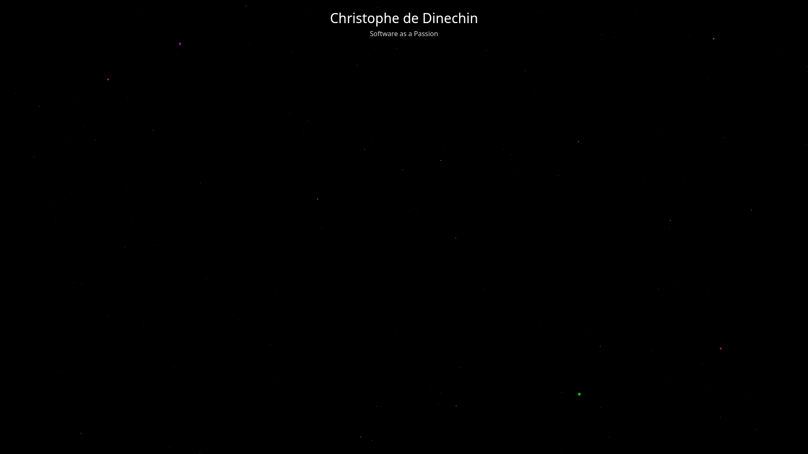
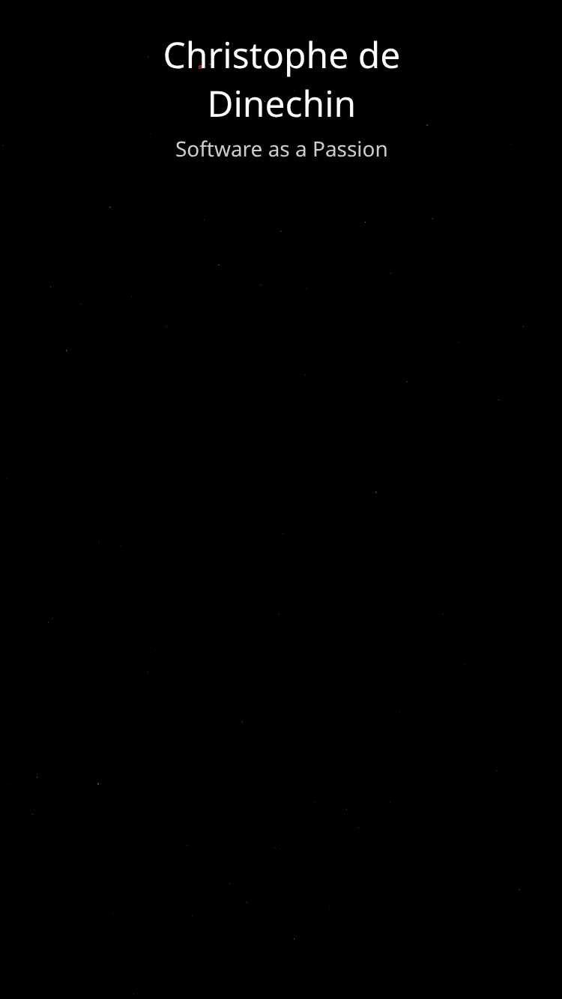
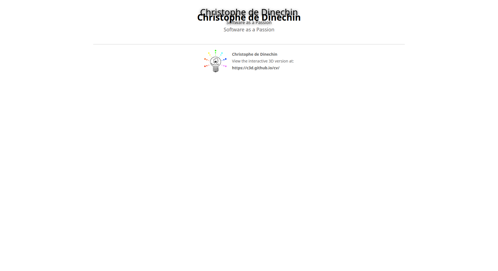

# Screenshot Gallery

## Desktop Views

### Overview - Initial Load

*The 3D constellation on initial load, showing the loading screen with the lightbulb logo*

### Constellation Loaded

*Rainbow-colored particles filling the space, glowing stars grouped by theme*

### Intro Card with Deep Link

*The intro card opened via deep link (#intro), displaying the logo and content*

### Project Card with Video Embed

*DB48X project card showing YouTube video embed (FOSDEM 2024 talk)*

## Mobile Views

### Mobile Viewport (375x667)

*Responsive layout on mobile viewport - constellation adapts to smaller screen*

### Mobile Card

*Alpha Waves project card on mobile - touch-optimized with readable content*

## Print View

### Print Layout

*One-page CV format for printing, showing top projects grouped by theme with logo*

## Demo Video

A screen recording demonstrating the interactive features is available at:
`docs/cv-constellation-demo.mp4`

## Features Demonstrated

✅ **Logo Integration**
- Favicon (browser tab)
- Loading screen with pulse animation
- Intro card header
- Print view footer

✅ **3D Navigation**
- Rainbow particle background
- Glowing stars with theme-based colors
- Smooth camera movements
- Orbital controls (drag to rotate)

✅ **Interactive Cards**
- CSS3DRenderer places real DOM in 3D space
- YouTube video embeds work correctly
- Rich content with Markdown formatting
- Close with ESC or X button

✅ **Deep Linking**
- URL hash navigation (#intro, #db48x, etc.)
- Automatic camera fly-to on load
- Share specific projects directly

✅ **Mobile Support**
- Responsive card sizing
- Touch-friendly controls
- Optimized layout for small screens

✅ **Print View**
- Traditional CV layout
- Top 5 projects per theme
- Logo and contact information
- Link to interactive version
